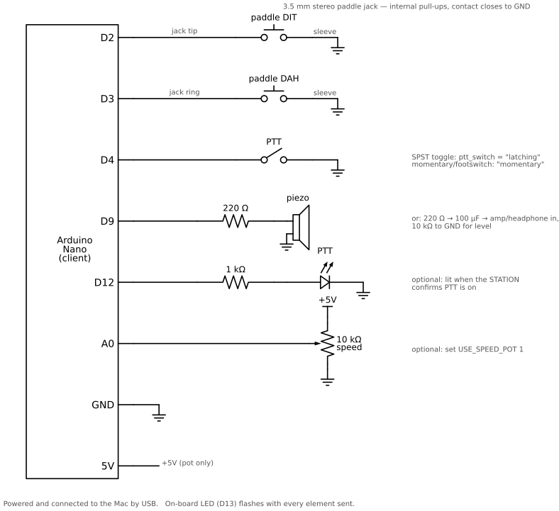
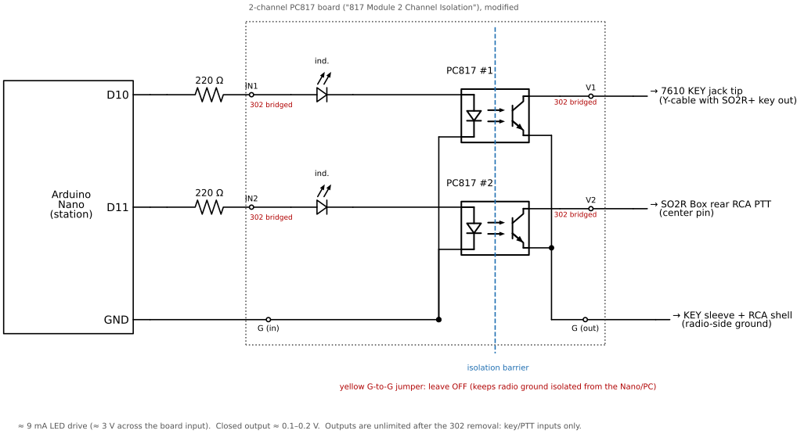
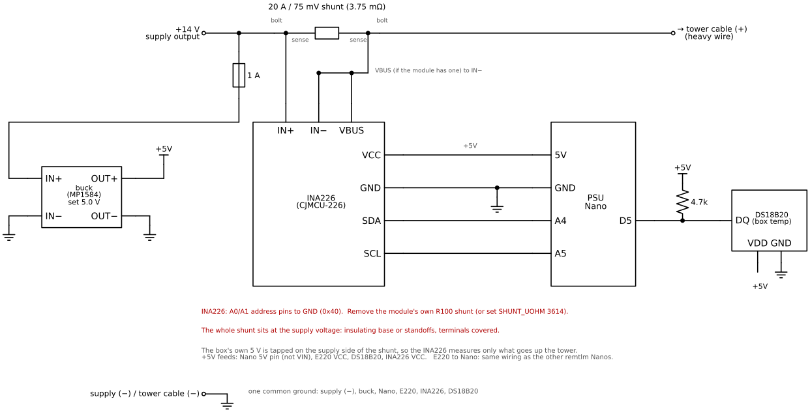
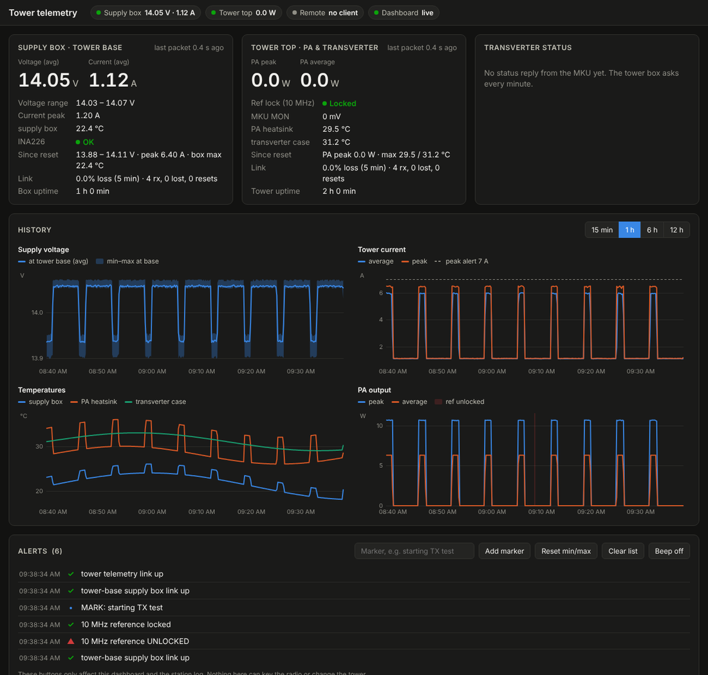

# remkey — remote paddle CW for the IC-7610 (or any rig with a KEY jack)

[](https://github.com/rusk2ua/remkey/actions/workflows/ci.yml)
[](LICENSE)

> **Status:** the software is complete and tested in CI (simulation, end-to-end network tests, and firmware builds for every Nano image), and it now runs end to end on the author's station (Oct 2026): a Mac paddle over Tailscale keys the IC-7610 and its tower-mounted 10 GHz transverter, with graceful PTT release and every safety stop checked. The tower telemetry (remtlm) has not yet run on real hardware. Sections 7 and 9 have the first-power-up checklists. Reports from real stations are very welcome.

Send CW with your own paddle from anywhere, with an instant local sidetone, and have the shack re-key it with perfect timing. Remote PTT (the TRANSMIT button) included.

remkey is built for a station where:

- A Windows PC in the shack already runs N1MM+, rig control and rotator control, and you reach it with AnyDesk.
- The 7610 drives a tower-mounted 10 GHz transverter through its SEND line, so PTT is manual and keying is CW.
- You travel with a Mac and want to use a real paddle.

It is two Arduino Nanos running the same sketch, plus a small Python bridge. Optional extra Nanos (**remtlm**, section 9) bring tower-top PA power, temperatures, reference lock and Kuhne transverter status, plus the tower supply's voltage and current from a box at the tower base, into the radio room over a LoRa link.

**Quick start:** wire and flash the Nanos (sections 1–3), run the station service on the shack PC (section 4), pick a network path (section 5), and run the client on your Mac (section 6). Do the bench test (section 7) before connecting anything to the tower. For a step-by-step checklist from ordering parts to a hardened station, see [docs/build-plan.md](docs/build-plan.md).

```
  TRAVEL END (Mac)                                         SHACK (Windows PC)
 ┌───────────────────────┐                               ┌─────────────────────────────┐
 │ paddle ─┐             │                               │                             │
 │ PTT btn ┼─► CLIENT    │ USB  remkey.client   TCP/JSON │ remkey.station   USB        │
 │ speaker◄┘   Nano      ├────► (Python)  ─────────────────► (Python)  ──────► STATION │
 │  (local sidetone,     │      keyboard CW,  internet   │  auth, heartbeat,  Nano     │
 │   decodes paddle      │      hotkeys       (port-fwd  │  safety-off on     │        │
 │   to characters)      │                   or Tailscale│  link loss         │        │
 └───────────────────────┘                     tunnel)   │       opto ─► KEY jack      │
                                                         │       opto ─► PTT/SEND      │
                                                         │  N1MM+ / SO2R+ untouched    │
                                                         └─────────────────────────────┘
```

## Why it works this way

Sending raw key-down/key-up events across the internet doesn't work: network jitter stretches and chops your dits and dahs. remkey splits the job instead:

1. **At your end,** the client Nano is a normal iambic keyer with its own sidetone. You hear yourself with zero latency. It decodes each character you send and reports it over USB, for example `K:C`.
2. **Characters** cross the network, not element timing.
3. **At the shack,** the station Nano re-sends each character with exact timing on an optocoupler across the 7610's KEY line.

The radio transmits each character roughly one character-time after you send it. That's under a second at 15–20 WPM, which doesn't matter on 10 GHz. You still hear the radio's real sidetone in the remote audio stream (delayed), so you can confirm what actually went out.

Anything the decoder doesn't recognise, such as SK or a fumbled character, is passed through as a raw element pattern like `{...-.-}`. The station sends it element-for-element, so nothing is lost or "corrected."

**Long dash strings (antenna peaking).** Hold the dah paddle and the far end hears zeros: once a 6th dah follows five, the client sends those five as `0` and keeps going, so the station starts sending about one group (~1.3 s at 18 WPM) after you start, rather than after you stop. When you let go, the leftover dashes go out as an ordinary character (T, M, O).

## Contents

```
firmware/remkey/remkey.ino     Nano sketch (both roles)
firmware/remkey/config.h       role, pins, defaults
firmware/platformio.ini        optional PlatformIO/VS Code build
firmware/remtlm/               tower telemetry over LoRa (tower, psu + base roles), section 9
host/remkey/station.py         shack service (Windows)
host/remkey/client.py          travel client (macOS; Linux works too)
host/remkey/protocol.py        network protocol, CW text sanitiser
host/remkey/telemetry.py       remtlm packet parsing, calibration, link statistics
host/remkey/tlmview.py         bench viewer for calibrating the PA power sense
host/remkey/powerstats.py      tower supply statistics from the CSV log; suggested alert limits
host/remkey/e220.py            read or program an E220 LoRa module through a USB serial adapter
host/remkey/dashboard.py       telemetry web dashboard served by the station service (section 9)
host/remkey/web/dashboard.html the dashboard page (self-contained: no internet needed)
host/*.example.toml            config templates
host/tests/                    pytest: protocol, end-to-end over localhost, telemetry
tests/firmware_sim/            g++ simulation of the sketch (timing, decoder, watchdog)
.github/workflows/ci.yml       CI: Python on Linux/Windows/macOS, simulation, firmware builds
docs/build-plan.md             phased build checklist, parts to tower installation
CHANGELOG.md                   per-component versions and changes
CONTRIBUTING.md, SECURITY.md   how to run the checks; security model and reporting
```

---

## 1. Hardware

### Parts

| Qty | Part | Notes |
|---|---|---|
| 2 | Arduino Nano (ATmega328P) | Clones are fine. CH340 USB chips need no driver on current macOS or Windows. |
| 2 | PC817 (or 4N25/4N35) optocoupler | Station only: one for KEY, one for PTT |
| 2 | 470 Ω resistor | Opto LED current, about 8 mA with bare PC817s |
| 2 | 220 Ω resistor | Instead of the 470 Ω, with a ready-made 2-channel opto board (its indicator LED drops extra voltage; see Station Nano) |
| 1 | 3.5 mm stereo jack | Client paddle input |
| 1 | Momentary pushbutton/footswitch, or an SPST toggle switch | Client PTT (set `ptt_switch` in `client.toml`) |
| 1 | Piezo sounder or small speaker + 100 µF cap | Client sidetone; or feed a headphone amp |
| 1 | 220 Ω resistor | Sidetone series resistor |
| 1 | 10 kΩ pot (optional) | Client speed knob. Set `USE_SPEED_POT 1`. |
| — | Cables to the 7610 KEY jack and PTT line | Station |

### Client Nano (travel keyer)



| Nano pin | Connects to | Notes |
|---|---|---|
| D2 | Paddle jack **tip** (dit) | Internal pull-up; the paddle contact closes to GND |
| D3 | Paddle jack **ring** (dah) | Internal pull-up; the paddle contact closes to GND |
| GND | Paddle jack **sleeve**, and the GND side of everything below | Common ground |
| D4 | PTT switch, other side to GND | SPST toggle: `ptt_switch = "latching"`. Momentary button or footswitch: `ptt_switch = "momentary"` (in `client.toml`) |
| D9 | 220 Ω → piezo (+); piezo (−) to GND | Sidetone. Or 220 Ω → 100 µF → small amp/headphone input, with 10 kΩ to GND for level |
| D12 | 1 kΩ → LED anode; LED cathode to GND | Optional. Lights when the **station** confirms PTT is on |
| A0 | 10 kΩ pot wiper; pot ends to 5V and GND | Optional speed knob. Set `USE_SPEED_POT 1` in `config.h` |
| 5V | Top of the speed pot | Only needed with the pot |
| D13 | On-board LED (no wiring) | Flashes with every element you send |
| USB | Mac | Power and serial |

Swap paddles in `config.h` (`SWAP_PADDLES`) instead of rewiring.

**LEDs (both roles):** the on-board LED (D13) flashes with the CW being sent: paddle elements on the client, re-keyed text on the station. `LED_ACTIVE_LOW` in `config.h` sets its polarity. It's 1 by default, for clones whose LED lights on LOW; set it to 0 for a genuine Nano. PTT state goes to an optional external LED on D12 (D12 ── 1 kΩ ── LED ── GND).

### Station Nano (shack)

```
            ┌──────────── PC817 #1 ─────────────┐
D10 ─ 470Ω ─┤1 anode               collector  4 ├── KEY line (tip) ──► 7610 KEY
GND ────────┤2 cathode             emitter    3 ├── KEY ground (sleeve)
            └───────────────────────────────────┘
            ┌──────────── PC817 #2 ─────────────┐
D11 ─ 470Ω ─┤1 anode               collector  4 ├── PTT/SEND-in line ──► 7610
GND ────────┤2 cathode             emitter    3 ├── chassis ground
            └───────────────────────────────────┘
```

The block diagram above shows bare PC817 chips with 470 Ω drive. The schematic below uses a modified ready-made 2-channel PC817 board instead, driven through 220 Ω (details of the modification follow).



| Nano pin | Through | Board terminal | Board output | Goes to |
|---|---|---|---|---|
| D10 (KEY) | 220 Ω | IN1 | V1 | 7610 KEY jack tip, Y-cabled with the SO2R+ keying output |
| D11 (PTT) | 220 Ω | IN2 | V2 | SO2R Box rear RCA **PTT** jack, center pin |
| GND | — | G (input side) | G (output side) | KEY sleeve and RCA shell (radio-side ground; *not* tied to the Nano GND) |

The optocouplers keep the Nano and PC USB ground galvanically separate from the radio, which matters on a station with a tower.

**Ready-made 2-channel PC817 boards** (sold as "817 Module 2 Channel Isolation") need two changes before they'll work here. Each channel has a 3 kΩ chip resistor (marked `302`) on the input side **and another in series with the output**:

- **Input 302:** in series with your own resistor it starves the LED (about 0.4 mA). Remove it and bridge the pads, then drive the LED from the Nano through 220 Ω: about 3 V across the board's input, LED clearly lit.
- **Output 302:** it forms a divider with the radio-side pull-up, so the "closed" output only gets down to about 1.6 V into a footswitch input with a pull-up of a few kΩ. KEY may still work while PTT doesn't. Remove it and bridge the pads; the closed output then reads about 0.1–0.2 V.
- The yellow jumper on each channel ties the output's emitter side to the board ground. Leave it off to keep the radio side fully isolated from the Nano.

With the 302s gone nothing on the output limits current, which is fine for key and PTT inputs (a few mA through the radio's own pull-up). Don't use the outputs to switch anything powered.

**KEY connection.** Both the SO2R+ and the remkey optocoupler are open-collector closures to ground, so they can safely share one line. Either:

- Y-cable the opto output in parallel with the SO2R+ keying output on the rear KEY jack (simplest; N1MM+ keeps working), or
- use the 7610's other key jack, configured for a straight key / external keyer.

Collector goes to the key line (tip), emitter to ground (sleeve). If keying does nothing, reverse it.

**PTT connection.** The opto has to put the *radio* into transmit, just like your TRANSMIT button. Your DC injector stays on the radio's SEND output and keeps working unchanged. Use an input that forces TX:

- **ACC socket SEND line:** on many Icom rigs this pin is bidirectional (it goes low on TX, and grounding it forces TX). Check the IC-7610 full manual's ACC pinout before wiring.
- **Front MIC connector PTT pin:** always a TX input. Check the manual for the pin number.

Do **not** wire the opto to the SEND output that drives your DC injector. That would key the transverter without the radio being in transmit.

**With a YCCC SO2R Box (plus):** the simplest PTT input is the box's rear RCA **PTT** footswitch jack. It keys the transmit-focus radio's PTT through the box's radio cable, so your SEND-driven sequencing works unchanged. (The DB25 is the box's auxiliary connector and has no PTT or key pins.) This is what the author uses, with the KEY opto in parallel with the box's keying output; N1MM+ and a local paddle through the box keep working.

---

## 2. Radio settings (IC-7610)

- **Break-in: OFF while operating remotely.** Then nothing goes up the IF cable unless PTT is on, which matches how you already operate (TRANSMIT first, then key). It also means stray keying with PTT off produces sidetone only.
- The jack the opto keys must be set for a **straight key / external keyer**, not paddles. The station Nano is the keyer.
- Keep the 7610's USB audio codec streaming to the shack PC so you can hear receive audio (and the radio's sidetone) through AnyDesk. See section 6.

---

## 3. Firmware

Build with the Arduino IDE (board **Arduino Nano**; processor "ATmega328P", or "Old Bootloader" for most clones) or with PlatformIO in VS Code.

**Arduino IDE.** Open `firmware/remkey/remkey.ino`. In `config.h`, set

```c
#define REMKEY_ROLE ROLE_CLIENT     // for the travel Nano
#define REMKEY_ROLE ROLE_STATION    // for the shack Nano
```

and upload each.

**PlatformIO:**

```
cd firmware
pio run -e client  -t upload --upload-port /dev/cu.usbserial-110
pio run -e station -t upload --upload-port COM7
```

**Check it.** Open a serial monitor at 115200 baud with line ending set to newline. You should see `V:remkey 0.1.0 client` (or `station`). Type `?` to get a status line. On the client, send a few characters with the paddle and you'll see `K:` lines. On the station, `T:CQ` keys the opto and `P:1` / `P:0` drive PTT.

Station watchdog: with PTT on or text queued, if the Nano hears nothing from the PC for 3 s it drops PTT, flushes text and prints `!:WDOG`. The service sends a heartbeat every second, so this only fires if the service or PC hangs.

The serial command set is documented at the top of `remkey.ino`.

---

## 4. Shack PC: station service (Windows)

1. Install Python 3.11+ from python.org (tick "Add to PATH").
2. Install remkey:
   ```
   cd remkey\host
   py -m pip install -e .
   ```
3. Configure:
   ```
   py -m remkey.genkey                  (copy the output)
   copy station.example.toml station.toml
   ```
   Edit `station.toml`: paste the secret and set `keyer_port` to the station Nano's COM port (Device Manager → Ports; *not* the SO2R+ or 7610 port).
4. Test without hardware:
   ```
   py -m remkey.station --config station.toml --dry-run
   ```
5. Run for real:
   ```
   py -m remkey.station --config station.toml
   ```
6. To start it automatically, use `host\Start-remkey.bat`. It runs the service from the `host` folder (using `host\.venv` if you made one, otherwise `py`), titles the window "remkey station", and if the service ever stops it leaves the window open with the exit code. Create a Task Scheduler task:
   - **Name:** remkey station. **Trigger:** At log on (your user).
   - **Action:** Start a program. **Program/script:** the full path to `Start-remkey.bat`. **Start in:** the `host` folder.
   - **Turn off console QuickEdit** for your user, once, in a Command Prompt:
     ```
     reg add HKCU\Console /v QuickEdit /t REG_DWORD /d 0 /f
     ```
     With QuickEdit on, a click in the window while it's opening at logon can put it into "Select" mode, which freezes the service until a key is pressed. remkey also turns QuickEdit off itself, but only once Python has started. The registry setting closes that gap.

   To check it, reboot, and before touching the window, connect a client and key PTT. Log lines should appear without pressing anything.

The service logs to the console and `remkey-station.log`. It accepts one client at a time.

---

## 5. Getting from the road to the shack

The client makes one outbound TCP connection. Pick one option; all work with the same software.

### Recommended: Tailscale

Encrypted, nothing exposed on the router, and it works with a VPN such as NordVPN running on the shack PC. Set `listen_host = "127.0.0.1"`, publish the port to your tailnet with `tailscale serve --bg --tcp 7373 tcp://127.0.0.1:7373`, and point `station_host` at the shack PC's Tailscale address. Full setup, including NordVPN coexistence: [docs/remote-access-tailscale-nordvpn.md](docs/remote-access-tailscale-nordvpn.md).

### Option A: router port-forward (free)

- On the Spectrum router, forward **TCP 7373** to the shack PC's LAN IP. Give the PC a DHCP reservation first.
- Windows Defender Firewall: allow inbound TCP 7373 for `python.exe`. Windows usually prompts on first run.
- In `station.toml`, set `listen_host = "0.0.0.0"`.
- In `client.toml`, set `station_host` to your public IP. Check it from the shack PC over AnyDesk if it ever changes.

**Security model:** a challenge-response HMAC with your secret (a fresh nonce every connection, so it can't be replayed), one client at a time, and a CW text whitelist. Traffic isn't encrypted. CW text isn't secret, and the risky operation is PTT, which needs the secret. Use a long generated secret.

### Option B: AnyDesk TCP tunnel (nothing exposed on the router)

This requires an AnyDesk plan that includes TCP tunneling.

1. In `station.toml`, set `listen_host = "127.0.0.1"`.
2. In AnyDesk on the Mac, open the shack PC's entry and choose **TCP tunnel → forward**: local port 7373 → `127.0.0.1:7373` on the remote side.
3. In `client.toml`, set `station_host = "127.0.0.1"`. The tunnel exists only while the AnyDesk session is open.

---

## 6. Mac: client

1. Install Python 3.11+ (`brew install python`), then:
   ```
   cd remkey/host
   python3 -m pip install -e .
   cp client.example.toml client.toml
   ```
   Paste the same secret, and set `station_host`, `station_port` and `keyer_port` (`ls /dev/cu.usbserial-* /dev/cu.usbmodem*`).
2. Run it in a terminal window:
   ```
   python3 -m remkey.client --config client.toml
   ```
   Without the travel Nano you still get keyboard CW: add `--dry-run`.

### Hotkeys

| Key | Action |
|---|---|
| PTT button on the keyer, or **Ctrl-T** | Toggle station PTT (the D12 PTT LED lights when the station confirms). Turning PTT off is a graceful release (see below). Pressing it again during the release keeps PTT on. |
| PTT toggle switch (`ptt_switch = "latching"`) | ON turns station PTT on, OFF is the graceful release. After a safety stop with the switch still ON, turn it off and on again to transmit; a switch left ON when the client starts doesn't key. Ctrl-T still toggles. |
| **Esc** | Abort queued text and any tune carrier. During a release, also drops PTT immediately. |
| **Ctrl-U** | Tune carrier (`tune_ms`, capped by the station). Needs PTT on. |
| **Ctrl-F / Ctrl-S** | Speed +1 / −1 WPM, both ends |
| **Ctrl-G** | Status: link, PTT, WPM, round-trip time (plus tower telemetry if fitted) |
| **Ctrl-P** | Tower: PA power, transverter power, temperatures, 10 MHz reference lock |
| **Ctrl-K** | Tower: Kuhne MKU 10 G5 status (`s`) and firmware version (`v`) |
| **Ctrl-V** | Tower: supply voltage and current, measured cable resistance and drop |
| **Ctrl-Q / Ctrl-C** | Quit. With PTT on, it first lets the station finish sending and release PTT (up to 15 s). Press again to quit at once. |
| Typing | Sent as CW. Enter sends a space. `<SK>`, `<AR>`, `<BT>`, `<KN>` send prosigns. |

### A typical 10 GHz QSO

1. In AnyDesk, set the frequency and point the dish with GH Everyware as usual.
2. Press the PTT button. Wait for the PTT LED (station confirmed), then wait for the tower sequencer as you would locally.
3. Send with the paddle. Your local sidetone paces you; the remote audio lets you confirm.
4. Press the PTT button again when you've finished sending. You don't need to wait for the station to catch up: it keys out everything still queued, holds PTT for 2 s more, then drops it. The client shows `STATION PTT releasing` until then, and the PTT LED stays lit.

### PTT release

The station runs about one character behind you, so pressing PTT off right after your last character would otherwise cut it short. Instead, PTT-off is a graceful release:

- The station Nano keys out everything already queued, then holds PTT for `ptt_hang_ms` (2000 ms by default, set in `station.toml`).
- Any CW that arrives during the hold (a character still in flight from the paddle, or you deciding to keep sending) is keyed and restarts the hold. **PTT never drops while CW is still being sent.** There is no upper limit; the hold ends only when nothing has been sent for the hang time.
- Pressing PTT again during the hold keeps PTT on. **Esc** during the hold drops PTT at once.
- The client Nano reports a character you've just finished before the PTT button press, so it reaches the station ahead of the release.
- The safety stops below are never delayed by the hold.

### Audio

The receive audio path is independent of remkey. AnyDesk's own audio transmission carries it one way (radio → shack PC → Mac); this setup is verified on the IC-7610:

1. **Sound → Recording:** the 7610's input (e.g. *Microphone – 3- USB Audio CODEC*) → Properties → **Listen** → tick **Listen to this device**, playback through the PC's normal output.
2. **Sound → Playback:** the default (green check) is the PC's normal output, e.g. an HDMI monitor. It doesn't need speakers; it just has to show *Ready* / *Default Device*. **Never** make *Speakers – USB Audio CODEC* the default: that's the radio's transmit input.
3. **AnyDesk on the shack PC → Settings → Audio:** **Audio Transmission = "Audio output of this device"**, not the radio's codec. (Pointing it at the codec sends the silent transmit side, so the Mac hears nothing.)
4. **AnyDesk → Settings → Permissions:** "Hear my device's sound" ticked in both the **Unattended Access** and **Default** profiles.
5. **Restart AnyDesk on the shack PC and reconnect** after any audio change; a running session doesn't pick it up.

Quick check: play a YouTube video on the shack PC. If you hear it on the Mac, the radio comes through the same way. If an HDMI monitor sleeps, Windows may drop its audio device, so set the display to never turn off. Before relying on it, confirm the radio's CW sidetone is present in the stream: key the rig locally with BK-IN off and listen.

### Safety layers

Every one of these drops PTT and flushes queued text **immediately**, with no release hold:

| Event | Where |
|---|---|
| TCP connection closes or errors | station service |
| No heartbeat from the client for 3 s (dead hotel Wi-Fi, laptop sleeps) | station service |
| Station service or PC hangs, USB unplugged | station Nano watchdog (3 s) |
| Tune carrier | capped by the service (`max_tune_ms`) and the firmware (30 s hard cap) |

Quitting the client is not on this list: it requests a normal release and waits for it (up to 15 s, or press Ctrl-Q again).

Paddle characters sent while the link is down are **dropped**, not buffered, so stale CW never goes out minutes later.

---

## 7. Bench test before connecting to the tower

1. Station Nano on the PC, opto outputs to a multimeter (continuity) or LEDs, not the radio yet.
2. Run the service, connect the client on the same LAN (`station_host` = the PC's LAN IP), and check:
   - PTT button → PTT opto closes, D12 PTT LED on at both ends.
   - Paddle → KEY opto follows about one character behind; local sidetone is immediate.
   - Kill the client's Wi-Fi with PTT on → PTT opens within 3 s.
   - Stop the service with PTT on → the Nano opens PTT within 3 s (`!:WDOG`).
   - Unplug the station Nano's USB with PTT on → PTT opens at once (the Nano loses power). Plug it back in: the service reconnects and re-arms it by itself.
   - Unplug the client Nano's USB with PTT on → the client releases PTT gracefully (queued CW still goes out, then the hang). Plug it back in: the paddle works again without restarting the client.
3. Connect to the 7610 into a dummy load at the IF with the transverter disabled. Check KEY polarity and PTT.
4. Test from your phone's hotspot over the port-forward or tunnel.

---

## 8. Development

```
cd host && python3 -m pip install -e ".[test]" ruff && ruff check . && python3 -m pytest -q
tests/firmware_sim/run.sh       # needs g++; runs the sketch against a mock Arduino
```

GitHub Actions runs all of this on every push and pull request, plus an `arduino-cli` build of every firmware image (remkey client and station; remtlm tower, tower with its own INA226, base and psu). The resulting `.hex` files are attached to each CI run as artifacts. See CONTRIBUTING.md.

The firmware simulation checks:

- PARIS at 20 WPM takes exactly 46 units with 22 units of key-down.
- Raw patterns and word spacing.
- Iambic A/B squeeze behaviour.
- Paddle decode of `CQ TEST K2UA`, and unknown patterns.
- Tune timing and the 30 s cap.
- The watchdog, with and without heartbeats.
- PTT button debounce.
- That the client paddle never drives the KEY output.
- remtlm (mocked E220, OneWire and INA226): the psu node slots its `$RS` ~60 ms after each tower `$RT`, falls back to its own 2 s timer when the tower is silent, ignores corrupt packets, reports a missing INA226 and a reversed shunt; the tower sends `$RP` only with `PWR_ENABLE 1`; the base forwards `$RS` and counts bad packets.

Every firmware image builds with no warnings in the project's own files (`arduino-cli`, board Arduino Nano, `--warnings all`):

| Image | Flash | Static RAM |
|---|---|---|
| remkey client / station | 7.9 KB of 30 KB | 541 B of 2 KB |
| remtlm tower with its own INA226 (`PWR_ENABLE 1`; 0.3.0 figures) | 18.8 KB | 1056 B |
| remtlm psu | 17.5 KB | 832 B |
| remtlm base | 7.8 KB | 458 B |

Library versions used in CI: EByte LoRa E220 library 1.0.8, OneWire 2.3.8, DallasTemperature 4.0.6.

## 9. Tower telemetry (remtlm)

Three more Nanos bring tower readings into the radio room over one LoRa channel. Two of them transmit, from two boxes on the tower, and one receives in the shack.

The **tower-top box** (TOWER image) is set up for a **Kuhne MKU 10 G5** transverter and an external PA:

- **PA power sense** (0–5 V), peak and average, sampled every 5 ms so CW dits aren't missed
- **MKU MON** output (CON1 pin 9), the transverter's own power monitor
- **10 MHz reference lock** from the MKU's LD output (CON1 pin 16); any unlock during a reporting interval is reported
- **Two DS18B20 probes**: PA heatsink and MKU case
- **The MKU's serial status**: the `v` (firmware) reply once after boot, then the `s` (status) reply every minute, relayed verbatim

The **supply box at the tower base** (PSU image) is separate, so it can go in before the top box and keeps reporting if the top box is down:

- **Supply voltage and current** going up the tower, from an INA226 and a shunt at the supply output: min, average and peak for every interval
- **One DS18B20** for the box temperature
- Its own sequence number and uptime, so the station tracks its link loss and resets separately

The top box can optionally get its own INA226 as well (`PWR_ENABLE 1`). With both, the station shows the **measured cable drop**, works out the **cable's actual resistance**, and checks the voltage the MKU actually sees (see "Supply voltage, current and cable drop" below).

```
 TOWER TOP                                                  RADIO ROOM
┌──────────────────────────────────────────┐            ┌──────────────────────────────┐
│ PA sense ─────────► A0 ┐                  │  927.125   │ E220 ─► BASE Nano ─USB─► PC   │
│ MKU pin 9 MON ────► A1 │                  │    MHz     │  validates packets   station  │
│ MKU pin 16 LD ────► A2 ├─ TOWER ─► E220 ~~~~~~~~~~~~~~►│  from both boxes     service  │
│ DS18B20 ×2 ───────► D5 │   Nano     $RT  │    LoRa    │  ─► client: Ctrl-P, Ctrl-K,   │
│ MKU pins 11/12 ◄──► D11/D12 (via shifter)│     ▲      │     Ctrl-V, alerts, TX summary│
│ (optional INA226 ─► A4/A5)               │     ║      │                              │
└───────────────▲──────────────────────────┘     ║      └──────────────────────────────┘
                ║ tower cable (+/−)              ║
 TOWER BASE     ║                                ║
┌───────────────╨──────────────────────────┐     ║
│ 14 V supply ═► shunt ═► tower cable       │     ║
│ INA226 on the shunt ─► A4/A5 ┐            │     ║
│ DS18B20 (box temp) ──► D5    ├─ PSU ─► E220 ~~~╝  $RS, just after each $RT it hears
│                              │  Nano      │
└──────────────────────────────────────────┘
```

There is no conductor between the tower and the house, so the link adds no lightning path. Everything ends up in the same station service and Mac client as remkey.

**The transverter link is read-only.** The tower only ever sends `s` and `v`, which read status, never the configuration commands (`IR`/`IT`/`RR`/`RT`/`D1`–`D4`). A garbled byte can't retune the IF or change the sequencer.

### Which Nano is which

With remtlm, the station has up to five Nanos. Each is a separate board on its own USB port or in its own box; the remtlm base does **not** replace the remkey station Nano.

| Nano | Where | Firmware | Connects to |
|---|---|---|---|
| remkey station | Shack PC (USB) | remkey, station role | `keyer_port` in `station.toml`, and the 7610 keying lines |
| remtlm base | Shack PC (USB) | remtlm 0.4.0, base | `tlm_port` in `station.toml`, plus its own E220 |
| remtlm psu | Supply box at the tower base | remtlm 0.4.0, psu | Its own E220, INA226, DS18B20 |
| remtlm tower | Tower-top box | remtlm, tower | Its own E220, PA and MKU sense lines, probes |
| remkey client | Travel end (Mac, USB) | remkey, client role | Paddle and PTT switch; the Mac client by USB |

The station service opens both shack ports. The keying path and the telemetry path share no hardware, so a telemetry fault can't affect keying: unplugging the remtlm base only raises a "lost" alert.

### Frequency and legality

- The link runs on **927.125 MHz** (E220-900T22D channel 77, set by `LORA_CHANNEL` in `firmware/remtlm/config.h`). That's the top of the US 902–928 MHz band and about 24 MHz clear of 902–903 weak-signal work.
- Treat the link as part of your **amateur station (Part 97)**. 927 MHz is in the 33 cm band, the packets are plain ASCII with no encryption, every packet carries your callsign, and §97.221(b) allows automatic control of data emissions on 6 m and shorter. It is *not* a Part 15 device in this configuration: a single-channel module at 17 dBm doesn't fit the unlicensed rules.
- Airtime: roughly 60–70 ms per packet at the 9.6 kbps air rate. The top box sends a `$RT` every 2 s while idle and every 0.5 s while the PA shows output (plus a `$RP` before each one if it has its own INA226).
- **Two transmitters, one channel.** The base E220 can only listen on one channel, so both boxes use channel 77. To keep them from colliding, the supply box listens too: it sends its `$RS` about 60 ms after the end of each tower `$RT` it hears, in the gap before the tower's next packet, which is at least 0.5 s away. If it hears no tower packet for 3.5 s (top box down, or not built yet), it sends every 2 s on its own timer. It never sends more often than every 0.4 s.
- Transmit power defaults to 17 dBm, which is plenty for 200 ft through block. Raise it with `LORA_TX_POWER` if the link is marginal.

### Parts

| Qty | Part | Notes |
|---|---|---|
| 3 | Ebyte E220-900T22D | All must be the **900** version |
| 3 | 915 MHz antenna (SMA) | A whip is fine; a small yagi at the house end if needed |
| 3 | Arduino Nano | Tower top, supply box, radio room |
| 9+9 | 1 kΩ and 2 kΩ resistors | 5 V → 3.3 V dividers on E220 M0, M1 and RXD, at each Nano |
| 3 | 100 µF electrolytic | Across the E220 VCC/GND pins (TX current peaks) |
| 2 | 5 V buck module (MP1584 or similar) + 1 A fuse | Tower top and supply box: supply → 5 V |
| 1 | AMS1117-3.3 module (or any 3.3 V LDO) | Tower: low-voltage side of the level shifter |
| 1 | 4-channel BSS138 level-shifter module | Tower: Nano ↔ MKU serial (3.3 V) |
| 2 | DS18B20 waterproof probes + one 4.7 kΩ resistor | Tower: both on one bus |
| 2 | 10 kΩ + 22 kΩ resistors, 100 nF caps | Tower: input dividers for A0 and A1 |
| 1 | 100 kΩ resistor | Tower: pull-down on A2 (LD) |
| — | 2.54 mm female header/jumper wires | Tower: to MKU CON1 |
| 1 | INA226 module (e.g. CJMCU-226) | Supply box: supply monitor, I2C address 0x40 |
| 1 | 20 A / 75 mV panel-meter shunt (3.75 mΩ) | Supply box: in the + feed to the tower cable (see below) |
| 1 | DS18B20 probe + 4.7 kΩ resistor | Supply box: box temperature |
| 1 | Weatherproof box with cable glands | Tower |
| (1+1) | INA226 module + shunt | Optional, tower top (`PWR_ENABLE 1`): measured cable drop |

### Wiring: E220 to Nano (same on all three Nanos)

The E220's logic is 3.3 V and not every pin is 5 V tolerant, so the three Nano outputs go through dividers.

```
E220 pin   Nano
M0   ◄──── 2k ──┬── 1k ──── D9        (each divider: Nano ─1k─┬─ E220 pin
M1   ◄──── 2k ──┼── 1k ──── D10                               └─2k─ GND)
RXD  ◄──── 2k ──┼── 1k ──── D8
            GND ┘
TXD  ─────────────────────► D7
AUX  ─────────────────────► D6
VCC  ── 5 V ── 100 µF ── GND
GND  ── GND
```


### Wiring: tower Nano to the MKU 10 G5 and PA

```
13.8 V ── 1 A fuse ── buck (5.0 V) ──► Nano 5V pin (not VIN), E220 VCC, DS18B20s, shifter HV
                     5.0 V ── AMS1117-3.3 ──► shifter LV

PA sense      ── 10k ──┬── A0       MKU CON1 pin 9 (MON) ── 10k ──┬── A1
                       ├─ 22k ─ GND                                ├─ 22k ─ GND
                       └─ 100nF ─ GND                              └─ 100nF ─ GND

MKU CON1 pin 16 (LD) ─────────┬── A2        LD is 3.3 V via 330 Ω when locked; the
                              └─ 100k ─ GND  pull-down holds A2 low otherwise

MKU CON1 pin 11 (TXD) ── shifter LV1 ═ HV1 ── D11
MKU CON1 pin 12 (RXD) ── shifter LV2 ═ HV2 ── D12
MKU CON1 pin 15 (GND) ── GND                (common ground with the Nano)

DS18B20 #1 and #2: red 5V, black GND, both yellow ── D5; one 4.7k from D5 to 5V

Optional (PWR_ENABLE 1 in config.h), a second INA226 at the top-box entry:
INA226 module: VCC ── 5V, GND ── GND, SDA ── A4, SCL ── A5   (A0/A1 address pins to GND)

 from tower cable (+)        20 A / 75 mV shunt            to everything in the box
 +13.8 ══════════► [big bolt]══════════════════[big bolt] ══════► MKU, PA, relays, fuse, buck
                   (sense screw)            (sense screw)
                        │                         │
                       IN+                       IN- ── also VBUS on modules that
                                                        have a separate VBUS pin
```

The same wiring as schematics, in two parts: the signals (PA sense, MKU CON1, level shifter and probes), then the power feed with the optional top-box supply monitor. Without it, the 13.8 V feed goes straight to the fuse and the equipment.


**Notes:**

- **Why analog for LD:** a 5 V Nano needs about 3.0 V to read a digital high, and LD gives only 3.3 V through 330 Ω. That's too close, so A2 compares against 1.65 V instead.
- **LD tracks the external 10 MHz reference:** it's high only while the MKU is locked to an *external* 10 MHz reference. If you run without one, set `LOCK_MONITOR 0` so it doesn't alarm.
- **Probes:**
  - Clamp one DS18B20 under a heatsink screw near the PA device and the other on the MKU housing, both with thermal compound.
  - The MKU is rated for +55 °C case and disables transmit above +65 °C. The default alert for probe 2 is 50 °C.
  - Probe order on the bus is fixed by each probe's serial number, not by wiring. Warm one in your hand while watching `tlmview` to see which is which. Then set `temp_names` in `station.toml`, or swap the probes.
- **ADC reference:** measure the buck's 5 V rail with a DMM and enter it as `VREF_MV`. The ADC uses that rail as its reference.
- **Command terminator:** if the MKU doesn't answer `s`, it may want a line terminator. Set `XV_CMD_SUFFIX "\r"` in `config.h`.

### Wiring: supply box at the tower base (PSU Nano)

The same Nano and E220 block as the other two, plus the INA226 on a shunt in the supply's + output, and one DS18B20:

```
14 V supply (+) ══╦══► [bolt] 20 A / 75 mV shunt [bolt] ══════► tower cable (+)
                  ║         (sense)        (sense)
                  ║            │              │
                  ║           IN+            IN- (and VBUS, if the module has one)
                  ╚═ 1 A fuse ── buck (5.0 V) ──► Nano 5V pin (not VIN), E220 VCC, INA226 VCC, DS18B20

INA226 module: VCC ── 5V, GND ── GND, SDA ── A4, SCL ── A5   (A0/A1 address pins to GND)
DS18B20: red 5V, black GND, yellow ── D5; 4.7k from D5 to 5V
E220: same as "Wiring: E220 to Nano" above
14 V supply (−) ── tower cable (−) ── box ground (buck, Nano, E220, INA226)
```



- **Take the box's own 5 V from the supply side of the shunt.** Then the INA226 measures only what goes up the tower, not the box's own 30–120 mA.
- **The voltage reported is the supply's output** (load side of the shunt), not the voltage at the top. The cable drop is only measured once the top box has its own INA226; until then, Ctrl-V shows supply voltage and current only.
- **Antenna:** the supply box is closer to the house than the top box, so a whip on the box is plenty. Keep it a few feet from the tower cable.
- **Don't power the Nano from VIN at 14 V.** Its linear regulator would drop 9 V at up to ~120 mA during E220 transmit peaks, more than 1 W in a sealed box. Use a buck module or a 5 V USB supply.

**Supply monitor notes** (the supply box's INA226, and the optional one at the top):

- **Put the shunt ahead of everything it should measure.** In the supply box that is the feed to the tower cable. At the top it is the enclosure entry, ahead of everything including the tower Nano's own buck converter.
- **Heavy wires go on the big bolts; IN+ and IN- go on the small sense screws.** The sense screws give you a Kelvin connection: they measure the shunt element itself, not the resistance of the bolted joints. IN+ goes on the supply side, IN- on the load side.
- **The whole shunt sits at +13.8 V.** Mount it on its insulating base or on standoffs, clear of the metal enclosure, and cover the terminals.
- **Range:** with 3.75 mΩ the INA226 reads up to 21.8 A in 0.67 mA steps. At 4 A the shunt drops 15 mV and dissipates 60 mW; at 8 A, 30 mV and 0.24 W. Panel shunts run cool well below their rating.
- **`SHUNT_UOHM` is 3750 by default.** A different shunt needs only that value changed: millivolt rating ÷ amp rating, in µΩ (75 mV / 20 A = 3750).
- **CJMCU-226 modules have their own 0.1 Ω shunt (R100) on the board.** Remove it. Left in parallel with the panel shunt it makes readings 3.6% low (or set `SHUNT_UOHM 3614`).
- **The bus voltage is read on the load side of the shunt.** At the top that is the voltage your equipment actually sees; in the supply box, it's what goes into the cable. On modules with a separate VBUS pin, tie it to IN-.
- **Negative current means the shunt is wired backwards.** It is reported as-is, not hidden.
- **Trim to your meters:** compare against a DMM at the INA226 and a clamp meter, then set `v_scale` and `i_scale` in `station.toml`. No reflash needed. (One pair of trims covers both INA226s; with good shunts and modules they need little or no trim.)

### Wiring: base Nano (radio room)

Only the E220 block above (its schematic covers all three), plus USB to the shack PC. It receives both boxes; nothing else is needed for the second sender, except that it must run remtlm 0.4.0 or later, because older base firmware rejects `$RS` packets as bad. Put the module and its antenna where it has the best view of the tower, for example a window. A USB extension cable is fine.

### Optional: check each E220 with a USB serial adapter

This step isn't required, because the Nano firmware programs the module at every boot. But it's a quick way to prove each module works before you wire it in, and it never transmits.

Use any 3.3 V USB serial adapter, such as an FT232 board with its logic jumper set to **3.3 V**:

| Adapter | E220-900T22D | Notes |
|---|---|---|
| GND | GND | |
| 5V (or VCC) | VCC | Configuration draws only a few mA, so the adapter's own supply is fine |
| TXD | RXD | Crossed: the adapter's TX goes to the module's RX |
| RXD | TXD | |
| 3.3V (VCCIO) | M0 **and** M1 | Both HIGH = configuration mode. Connect before powering up. |
| — | AUX | Leave unconnected |

On a Mac the adapter shows up as `/dev/cu.usbserial-XXXX` (`ls /dev/cu.usbserial-*`); no driver is needed. Then run:

```
python -m remkey.e220 --port /dev/cu.usbserial-XXXX
python -m remkey.e220 --port /dev/cu.usbserial-XXXX --write
```

- **The first command** reads and decodes the module's current settings. A new module typically shows channel 18 (868.125 MHz), 2.4 kbps and 22 dBm.
- **The second** stores remtlm's settings and reads them back to verify: channel 77 (927.125 MHz), 9.6 kbps air rate, 17 dBm, transparent mode, no encryption.
- **If there's no reply,** check M0/M1, the TX/RX crossover and the 3.3 V logic jumper.

Afterwards, the Nano finds its module already set and skips the write at boot: no `C:written`, just `C:ok ch=77 freq_khz=927125`.

### Build and check

1. In the Arduino IDE, install **EByte LoRa E220 library** (Renzo Mischianti), **OneWire** and **DallasTemperature**. CI builds with versions 1.0.8, 2.3.8 and 4.0.6.
2. Open `firmware/remtlm/remtlm.ino`, set `REMTLM_ROLE` in `config.h` (`ROLE_TOWER`, `ROLE_BASE` or `ROLE_PSU`), and upload one image to each Nano. Alternatively, run `pio run -e tower` / `-e base` / `-e psu` from `firmware/remtlm`.
3. At boot, each Nano prints `V:remtlm 0.4.0 tower|base|psu`, then `C:ok ch=77 freq_khz=927125`. The first boot also prints `C:written`, since it writes the settings to the module once.
   - `C:ERR read config` means the Nano can't talk to the module: check the M0, M1 and AUX wiring and the module's power.
4. The tower also prints `I:temperature probes=2` (and `I:INA226 ok` if it has one).
5. The supply box prints `I:temperature probes=1` and `I:INA226 ok`, then `$RS,...` every 2 s. When it starts hearing the tower it prints `I:tower heard, sending in its gaps`, and from then on each `$RS` follows a tower `$RT`. If the tower goes quiet it prints `I:tower not heard, sending on own timer`.
   - `I:INA226 not found` means the I2C wiring or address is wrong; the Nano keeps working, reports `ok=0`, and retries every 5 s.
6. The tower and the supply box echo every packet they send on their own USB port, so you can watch them on the bench:
   - `$RT,...` readings, `$RK,...` transverter replies (the first, about 5 s after boot, is the `v` reply)
   - `$RS,...` supply-box readings
7. The base Nano prints only valid packets, from both boxes. `python -m remkey.tlmview --port <port>` shows them decoded, with `BASE supply` lines for the supply box.

### Shack configuration

In `station.toml`, set `tlm_port` to the base Nano's COM port. Then:

- **Ctrl-P** in the client prints the tower readings. **Ctrl-G** includes them.
- **Ctrl-K** prints the MKU's latest `s` status and its firmware version.
- **Ctrl-V** prints the supply voltage and current at the tower base, the box temperature and the box's link loss. With an INA226 in the top box too, it adds the top voltage, the measured cable drop and the cable resistance. Ctrl-P and Ctrl-G include a one-line supply summary.
- **Alerts** print on their own lines (`!!` = warning, `--` = cleared):
  - 10 MHz reference unlock
  - either probe at or above its limit (`temp_warn_c`, `temp2_warn_c`)
  - no packets for `tlm_stale_s`, separately for the top box (`tower telemetry lost`) and the supply box (`tower-base supply box lost`)
  - supply below `v_min_alert` or above `v_max_alert` (checked at each INA226, labelled `at tower base` or `tower-top`), current above `i_max_alert` or below `i_min_alert`, or an INA226 not answering
  - supply box at or above `box_temp_warn_c`
- **TX summary:** when you drop PTT, the client prints `last TX: PA peak … W | supply min … V, peak … A`.
- **CSV log:** every reading is also logged to `remkey-tlm.csv`, which gives you temperature, voltage and current history: one row per top-box packet, or per supply-box packet while the top box is silent. `supply_at` says where the voltage was measured (`base` or `top`), and `top_v_avg` holds the top voltage when both boxes measure. The station log records each transverter reply.

### Web dashboard

The station service can also serve a live telemetry page, for a second computer, tablet or phone in the radio room. It runs on the shack PC itself, so there's no extra hardware, and everything goes over your existing WiFi: no Ethernet cable anywhere near the station.



*(Screenshot with simulated data.)*

What it shows:

- **Supply box** (tower base): voltage, current, interval min/max and peak, box temperature, INA226 state, link loss and uptime, plus min/max since you last reset them.
- **Tower top**: PA peak and average power (W once `pa_cal` is set, mV before), MKU MON, 10 MHz reference lock, both probe temperatures, link loss. Until the top box exists this card just says it's waiting.
- **Transverter status**: the MKU's latest `s` reply and its firmware version.
- **History charts** (15 min to 12 h): supply voltage with its min–max band and alert lines, current (average and peak), all three temperatures, and PA output with reference-unlock periods shaded. Hover or tap a chart for exact values. After a restart the charts reload from `remkey-tlm.csv`.
- **Alerts**: the same alerts the Mac client prints, newest first. **Beep** sounds on new warnings (per browser; click it once to allow sound).
- The header shows each link's state, and whether a remote client is connected and PTT is on.

The buttons are deliberately harmless: **Add marker** writes a note (e.g. "starting TX test") into the station log, the alert list and the Mac client; **Reset min/max** starts new min/max and link-loss counts; **Clear list** empties the dashboard's alert list (the station log keeps everything). **Nothing on the page can key the radio, change PTT or send anything to the tower**, and the remkey keying path doesn't depend on it: if the dashboard can't start (say the port is taken), the station logs an error and keying comes up as usual.

**Turn it on** in `station.toml`, then restart the station service:

```toml
dash_port = 8080
```

The station log shows `dashboard on http://0.0.0.0:8080/`.

**Allow it through Windows Firewall** (once, in an administrator Command Prompt on the shack PC). This opens the port to your home network and Tailscale only:

```
netsh advfirewall firewall add rule name="remkey dashboard" dir=in action=allow protocol=TCP localport=8080 remoteip=LocalSubnet,100.64.0.0/10
```

**Open it:**

- On the home network: `http://<shack-pc-name>:8080`, e.g. `http://shackpc:8080`. If the name doesn't resolve, use the PC's IP address (`ipconfig` on the shack PC, the WiFi adapter's IPv4 address), e.g. `http://192.168.1.50:8080`. Bookmark it, or add it to the iPad home screen.
- Over Tailscale from the road: `http://<shack-pc's Tailscale name>:8080`, or its `100.x.y.z` address. Tailscale encrypts the traffic.

**Who can reach it.** The page answers only addresses in `dash_allow`, which defaults to private home-network ranges and Tailscale; anything else is dropped without a reply. It also only answers to an IP address or a plain machine name (`shackpc`, `shackpc.local`, `*.ts.net`) in the address bar; to use another name, list it in `dash_hostnames`. Those two checks, plus a header that only the page itself sends with its button presses, stop other websites from reaching it through your browser. The page has no password: anyone on your home WiFi can view it and press the three harmless buttons.

**Settings** (in `station.toml`): `dash_port` (0 = off), `dash_host` (`0.0.0.0` = all adapters), `dash_allow` (list of address ranges, e.g. `["192.168.1.0/24", "100.64.0.0/10"]`), `dash_hostnames` (extra names), `dash_history_h` (hours of chart history kept in memory, default 12). Up to 8 pages can be open at once.

### Supply voltage, current and cable drop

**What to expect.** Copper loop resistance for your 100 ft run (both conductors, 200 ft total, at 20 °C):

| Cable | Loop resistance | Drop at 4 A | Drop at 6 A | Drop at 8 A | Top voltage at 4 A (14.1 V at base) |
|---|---|---|---|---|---|
| #10 | 0.200 Ω | 0.80 V | 1.20 V | 1.60 V | 13.30 V |
| #12 | 0.318 Ω | 1.27 V | 1.91 V | 2.54 V | 12.83 V |

Connectors, the fuse and crimps add to that, and copper rises 0.39% per °C, about 8% between a winter and a summer day. The MKU 10 G5 is rated for 12–14 V. With #12, transmit current much above 6 A pulls the top of the tower below 12 V, which the alerts will catch.

**With only the supply box,** you get the supply's own voltage and the current going up the tower, which is enough to see the TX/RX current pattern, catch a box losing power (`i_min_alert`), and set current limits. The voltage at the top isn't measured; the table above is the estimate.

**With an INA226 in the top box too** (`PWR_ENABLE 1`), the drop is measured directly (base voltage minus top voltage), and the cable fit below runs on the top voltage.

**How the cable is measured.** You don't need to know the exact supply voltage. Every reporting interval gives an average current and voltage at the enclosure, and they always lie on one straight line: *V = V_supply − R × I*. As your current moves between receive and transmit, the station service fits that line and gets two numbers:

- **R:** the total resistance between the supply and the enclosure, cable plus connectors.
- **V_supply:** the voltage the supply is actually holding at the tower base. Compare it with the 14.1 V you set.

**Ctrl-V** shows both, plus which wire gauge R matches. If R is well above the #10 or #12 figure, look at connectors, crimps and the fuse holder before suspecting the wire. The fit needs at least 20 readings covering at least 0.5 A of current spread, which a few minutes of transmitting provides.

**Finding the normal range.** Leave the alert limits for current at 0 (off) and operate normally for a few days, including some transmitting. Then run:

```
python -m remkey.powerstats remkey-tlm.csv --config station.toml
```

It separates receive and transmit periods using the PA power sense, then prints:

- voltage and current ranges for each
- the cable fit
- suggested `v_min_alert`, `v_max_alert`, `i_max_alert` and `i_min_alert` values to paste into `station.toml`

A useful `i_min_alert` (current well below normal) catches something in the box losing power, for example the PA's fuse.

**If the drop turns out to be too large,** the options are heavier cable, raising the supply at the base (keeping the top under 14 V at receive current), or a supply with remote-sense terminals wired to the enclosure.

### Calibrating the PA power sense

Detector outputs aren't linear in power (Kuhne says the same of MON), so remkey uses a table you measure:

1. Put a power meter (through a suitable attenuator) on the PA output. On the bench before installation is easiest.
2. Run `python -m remkey.tlmview --port <tower Nano port>` and key a carrier (Ctrl-U tune, or locally) at several drive levels.
3. For each level, note the meter's watts and the `PA pk` mV reading.
4. Enter the pairs in `station.toml` as `pa_cal = [[mV, W], ...]`. Four or five points spanning low to full power are plenty.
5. Do the same with the MKU's output for `xv_cal` if you want MON in watts too.

Until a table is entered, readings are shown in mV.

### Parsing the MKU status

The manual lists what `s` reports (sequencer delays, frequency settings, reference PLL state) but not the reply's exact format, so it is relayed and displayed as-is. Once you've captured a real reply (Ctrl-K, `tlmview`, or the station log), its fields can be parsed so that, for example, a reference-PLL problem raises an alert from the serial status as well as from LD.

## Protocol reference

- Network protocol: JSON lines over TCP, documented in `host/remkey/protocol.py`.
- Serial protocol: newline-terminated commands at 115200 baud, documented at the top of `firmware/remkey/remkey.ino`.
- Telemetry packets: `$RT,...` tower readings, `$RS,...` supply-box readings, `$RP,...` optional top-box supply readings and `$RK,...` transverter replies, documented in `firmware/remtlm/tlm_proto.h`.

## License

MIT. © 2026 Rus Healy, K2UA.
