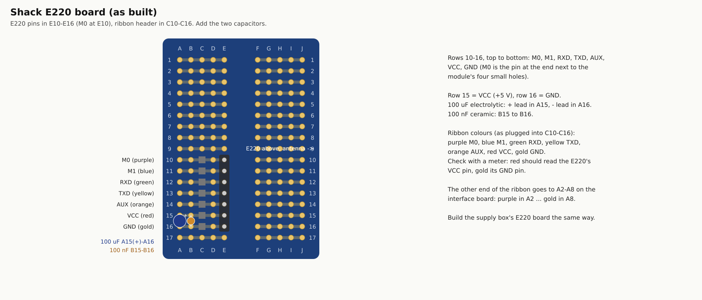
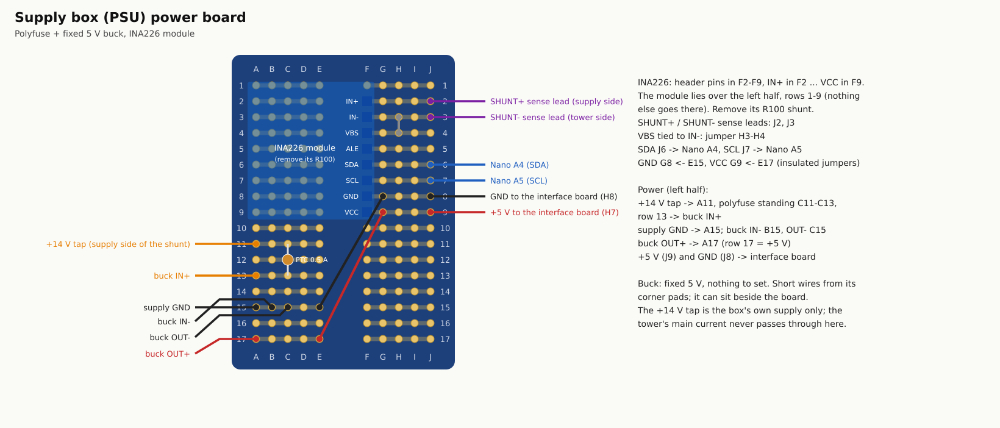

# remtlm prototype on ElectroCookie boards

A bench prototype of the shack (BASE) and supply-box (PSU) nodes, to run while the RK-301/RK-303 boards are on order. It uses ElectroCookie mini solderable breadboards and Nano screw-terminal carriers. The circuit is the same as the real boards (see `hardware/` and the schematics in `docs/img/`).

**The board layout:** rows 1–17. In each row, holes A–E are joined, and holes F–J are joined separately; the two halves don't connect. Every hole is named the way it's printed on the board (C2 is row 2, column C).

## What goes where

| Node | Boards | Nano |
|---|---|---|
| Shack | E220 board → ribbon → shack interface board | Screw-terminal carrier, USB from the shack PC |
| Supply box | E220 board → ribbon → PSU interface board, plus the PSU power board | Screw-terminal carrier, powered from its 5V terminal |

The shack E220 board as built: E220 pins in E10–E16 (M0 in E10 … GND in E16; M0 is the pin next to the module's four small holes), ribbon header in C10–C16. Build the supply box's E220 board the same way. The ribbon colours run purple M0, blue M1, green RXD, yellow TXD, orange AUX, red VCC, gold GND. The other end lands in A2–A8 of the interface board in that order: purple in A2 through gold in A8.

**Why there's an interface board:** the E220 uses 3.3 V logic, so the three Nano outputs that drive it (M0, M1, RXD) each need a 1k/2k divider. The 1k has to sit in series between the Nano pin and the E220 pin. On the E220 board each header pin shares a row with its E220 pin, so there's no place for it there.

### E220 board (both nodes)

### Shack interface board

### Supply-box interface board

### Supply-box power board

## Nano screw terminals

**Shack Nano** (BASE firmware; USB to the shack PC):

| Terminal | Goes to | Signal |
|---|---|---|
| D9 | Interface J2 | M0 (through 1k/2k) |
| D10 | Interface J3 | M1 (through 1k/2k) |
| D8 | Interface J4 | to E220 RXD (through 1k/2k) |
| D7 | Interface E5 | from E220 TXD |
| D6 | Interface E6 | E220 AUX |
| 5V | Interface E7 | E220 VCC |
| GND | Interface E8 | GND |

**Supply-box Nano** (PSU firmware):

| Terminal | Goes to | Signal |
|---|---|---|
| D9, D10, D8, D7, D6 | Interface J2, J3, J4, E5, E6 | Same as the shack |
| D5 | Interface G6 | DS18B20 DQ |
| A4 | Power board J6 | INA226 SDA |
| A5 | Power board J7 | INA226 SCL |
| 5V | Interface G7 | +5 V bus (powers the Nano; don't use VIN) |
| GND | Interface G8 | GND bus |

**Between the supply-box boards:** power board J9 (+5 V) → interface H7, and power board J8 (GND) → interface H8.

**Off-board wires, supply box:**
- +14 V tap (supply side of the shunt) → power board A11
- Supply GND → A15
- Shunt sense leads → J2 (SHUNT+, supply side) and J3 (SHUNT−, tower side)
- Buck: IN+ A13, IN− B15, OUT− C15, OUT+ A17
- DS18B20: yellow F6, red J7, black I8 on the interface board

## Parts

| Qty | Part | Where |
|---|---|---|
| 6 (3 per node) | 1 kΩ | Standing, E2–F2, E3–F3, E4–F4 |
| 6 (3 per node) | 2 kΩ | Lying flat, B2–B8, C3–C8, D4–D8 |
| 2 (1 per E220 board) | 100 µF electrolytic | A15 (+) to A16 |
| 2 (1 per E220 board) | 100 nF ceramic | B15 to B16 |
| 1 | 4.7 kΩ | Standing, I6–I7 (PSU interface) |
| 1 | Polyfuse, 0.5 A hold | Standing, C11–C13 (PSU power) |
| 1 | Fixed 5 V buck module | Beside the power board, short wires to its corner pads |
| 1 | INA226 module (R100 removed) | Header in F2–F9 of the power board |
| 1 | DS18B20 probe | PSU interface board |

## Bring-up order

1. **E220 board.** Before connecting anything, check with a meter that the red ribbon wire reaches the E220's VCC pin and the gold one its GND pin.
2. **Shack node.**
   - Wire it up and plug the Nano into the shack PC.
   - Open a serial monitor at 115200 first. It should show `V:remtlm … base` and then `C:ok ch=77 freq_khz=927125`. `C:ok` means the Nano read the E220's configuration through the ribbon and dividers, so that wiring is right. `C:ERR` means check the ribbon order, the dividers, M0/M1, and power on row 7/8.
   - Close the serial monitor, set `tlm_port` in `station.toml` to the Nano's COM port, and restart the station service. The dashboard's telemetry line changes from "off" to waiting for packets.
3. **Supply-box power board on its own.**
   - Bench supply at 13.8 V, current-limited to about 200 mA, into A11 and A15, with no INA226 and no Nano connected.
   - Check 5 V on row 17.
   - Then plug in the INA226 module.
4. **Supply-box Nano.**
   - Connect the interface board and the Nano, with the bench supply on. You can also plug the Nano's USB into a laptop for a serial monitor at 115200. That's fine alongside the 5 V terminal.
   - Expect these lines:
     - `V:remtlm … psu`
     - `C:ok ch=77 …`
     - `I:INA226 ok`
     - `I:temperature probes=1`
   - After that, a `$RS` line every 2 s with voltage, current (about zero with no load through the shunt) and box temperature. The PSU node echoes what it transmits to USB for bench work.
5. **Over the air.** With both nodes running, the shack dashboard and the cloud summary page show the supply box's readings within a few seconds.

Regenerate the drawings: `python3 docs/prototype/make_proto.py docs/prototype`, then convert each SVG to PNG.
