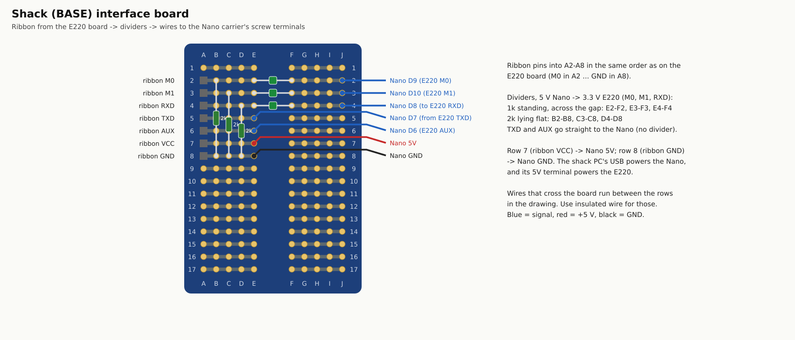
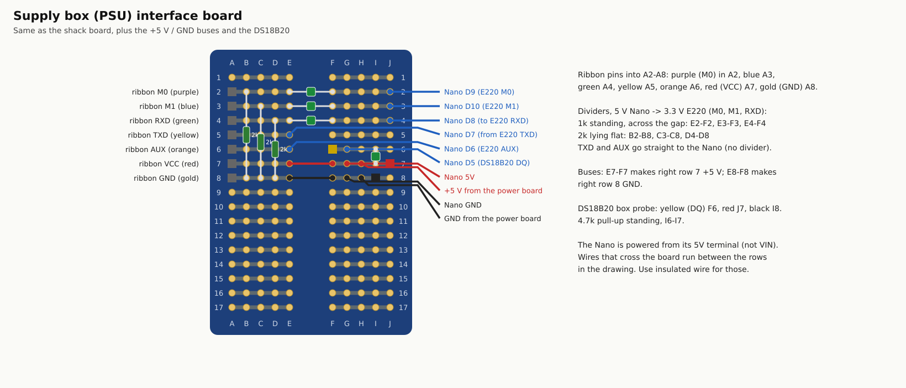
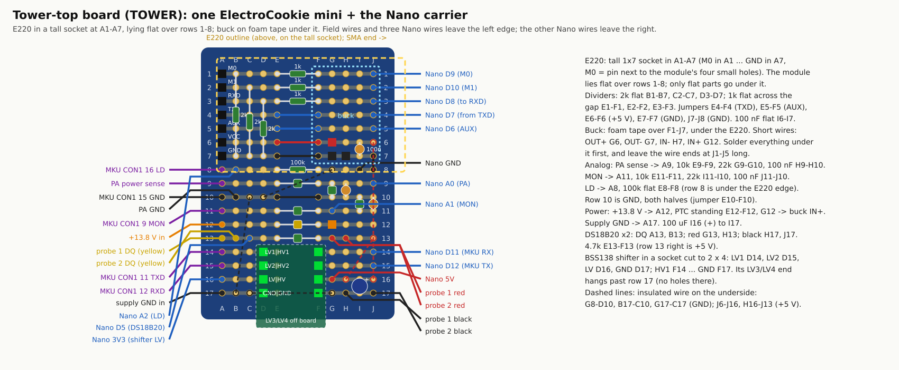
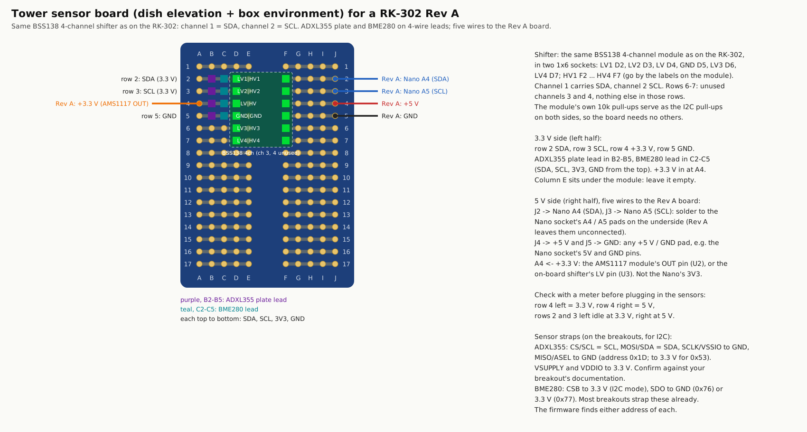

# remtlm prototype on ElectroCookie boards

A bench prototype of the shack (BASE), supply-box (PSU) and tower-top (TOWER) nodes, to run while the RK-301/302/303 boards are on order. It uses ElectroCookie mini solderable breadboards and Nano screw-terminal carriers. The circuit is the same as the real boards (see `hardware/` and the schematics in `docs/img/`).

**The board layout:** rows 1–17. In each row, holes A–E are joined, and holes F–J are joined separately; the two halves don't connect. Every hole is named the way it's printed on the board (C2 is row 2, column C).

## What goes where

| Node | Boards | Nano |
|---|---|---|
| Shack | E220 board → ribbon → shack interface board | Screw-terminal carrier, USB from the shack PC |
| Supply box | E220 board → ribbon → PSU interface board, plus the PSU power board | Screw-terminal carrier, powered from its 5V terminal |
| Tower top | One board: E220 in a tall socket, dividers, buck, analog inputs, MKU level shifter, probes | Screw-terminal carrier, powered from its 5V terminal |

The shack E220 board as built: E220 pins in E10–E16 (M0 in E10 … GND in E16; M0 is the pin next to the module's four small holes), ribbon header in C10–C16. Build the supply box's E220 board the same way. The ribbon colors run purple M0, blue M1, green RXD, yellow TXD, orange AUX, red VCC, gold GND. The other end lands in A2–A8 of the interface board in that order: purple in A2 through gold in A8.

**Why there's an interface board:** the E220 uses 3.3 V logic, so the three Nano outputs that drive it (M0, M1, RXD) each need a 1k/2k divider. The 1k has to sit in series between the Nano pin and the E220 pin. On the E220 board each header pin shares a row with its E220 pin, so there's no place for it there.

### E220 board (both nodes)

### Shack interface board

### Supply-box interface board

### Supply-box power board

### Tower-top board

Everything for the tower node is on one board, so the build order matters. The full step-by-step checklist, with meter checks, is in [tower-checklist.pdf](tower-checklist.pdf) (print it for the bench) and [tower-checklist.xlsx](tower-checklist.xlsx); `make_checklist.py` regenerates both. In short:

1. **Flat parts first, everything under the E220 and the buck:** the 2k and 1k dividers, the jumpers E4–F4, E5–F5, E6–F6, E7–F7, J7–J8, the 100 nF at I6–I7, the 100k at E8–F8, and the Nano wires at J1–J5 (leave them long). Nothing in rows 1–8 may stand taller than a resistor lying flat.
2. **The underside links** (dashed in the drawing), in insulated wire: G8–D10, B17–C10, G17–C17, H17–J13 (GND) and J6–J16, H16–A13 (+5 V).
3. **The buck** on foam tape over F1–J7, with short wires from its pads: OUT+ to G6, OUT− to G7, IN− to H7. Its IN+ pad takes the +13.8 V lead directly, through a 0.5 A PTC spliced into the lead and covered with heat shrink.
4. **The E220 socket** in A1–A7: M0 in A1 … GND in A7, so M0 (the pin next to the module's four small holes) is at row 1 and the module lies over the board, with its SMA end past the J edge. The socket has to hold the module above the buck: measure the buck's height plus the foam tape, and use a socket at least 1–2 mm taller. If one 8.5 mm female header isn't enough, stack two.
5. **The rest, rows 9–17:** standing parts are fine here.
   - PA sense: 10k E9–F9, 22k G9–G10, 100 nF H9–H10.
   - MON: 10k E11–F11, 22k I11–I10, 100 nF J11–J10.
   - Jumper E10–F10, so row 10 is GND on both halves.
   - Key line to the sequencer (MKU CON1 pin 8) into A12: 47k E12–F12, 100k pull-up D12–D13, 22k G12–G13, 100 nF H12–H13. Row 13 is +5 V on the left and GND on the right.
   - 100 µF I16 (+) to I17.
6. **The BSS138 shifter** in a 1x4 socket at D14–D17 (LV1, LV2, LV, GND) and another at F14–F17 (HV1, HV2, HV, GND). Its unused LV3/LV4 end hangs past row 17; with the module raised on sockets, those pins clear the board. Go by the labels printed on the module: LV1 at D14 and HV1 at F14. That works with only one side of the module facing up, and either side is fine electrically.

The level shifter's low side takes its 3.3 V from the Nano's 3V3 pin (A16). It draws only microamps there.

**Why the PTC and the probe pull-up aren't on the board:** the key-line network needed the two rows they used. The PTC goes in the +13.8 V lead, and the DS18B20 pull-up goes across the Nano carrier's D5 and 5V terminals.

**The key-line network** reads MKU CON1 pin 8, the active-low PTT output to the sequencer. The tower only watches it. The 100k pull-up makes an open line (sequencer unplugged or dead) read about 2 V, not "keyed". The 47k/22k divider keeps A3 under 5 V with up to about 15 V on the line, so it doesn't matter whether pin 8 is open collector or driven.

### Tower sensor board (dish elevation and box environment, for a RK-302 Rev A)

This board adds the ADXL355 (dish elevation) and the BME280 (temperature, humidity and pressure inside the box) to a RK-302 Rev A board. Both sensors are 3.3 V parts on I2C, and the Nano is a 5 V part, so they go through a level shifter. It's the same BSS138 4-channel module the RK-302 uses for the MKU serial link: channel 1 carries SDA, channel 2 SCL. Its own 10k pull-ups serve as the I2C pull-ups on both sides. (RK-302 Rev B does the same job on the board, with the spare channels 3 and 4 of its own shifter.)

1. **The shifter** in two 1x6 sockets: LV1 in D2 … LV4 in D7, HV1 in F2 … HV4 in F7, going by the labels printed on the module. Rows 6 and 7 hold the unused channels 3 and 4; nothing else goes in them. Column E is under the module: leave it empty.
2. **The sensor leads** on the 3.3 V side, each in the same order from the top (SDA, SCL, 3V3, GND): the ADXL355 plate in B2–B5, the BME280 in C2–C5. A 1x4 header in each lets you unplug them.
3. **Five wires to the Rev A board:**
   - J2 → the Nano's A4 (SDA) and J3 → A5 (SCL). Rev A leaves those socket pads unconnected: solder to them on the underside.
   - J4 → +5 V and J5 → GND, for example at the Nano socket's 5V and GND pins.
   - A4 ← +3.3 V from the board's AMS1117 module (U2's OUT pin), or the on-board shifter's LV pin (U3). Don't use the Nano's 3V3 pin for this.
4. **Before the sensors go in:** with the Rev A board powered, row 4 reads 3.3 V on the left and 5 V on the right. Rows 2 and 3 idle at 3.3 V on the left and 5 V on the right.

**The sensors:**

- **ADXL355 plate:** the breakout on its own small, stiff plate, bolted to the dish structure, with the 4-wire lead to B2–B5. Wired for I2C: CS/SCL to SCL, MOSI/SDA to SDA, SCLK/VSSIO to GND, MISO/ASEL to GND (address 0x1D; to 3.3 V for 0x53), VSUPPLY and VDDIO to 3.3 V. Check those straps against your breakout's documentation.
- **BME280:** anywhere in the box away from the buck and the Nano, on its lead to C2–C5. CSB to 3.3 V (I2C mode) and SDO to GND (0x76) or 3.3 V (0x77); most breakouts strap these already.
- The firmware finds either address of each sensor by itself, and it tells a real BME280 from a BMP280 (no humidity).

## Nano screw terminals

**Shack Nano** (BASE firmware; USB to the shack PC):

| Terminal | Goes to | Signal |
|---|---|---|
| D9 | Interface J2 | M0 (through 1k/2k) |
| D10 | Interface J3 | M1 (through 1k/2k) |
| D8 | Interface J4 | to E220 RXD (through 1k/2k) |
| D7 | Interface E5 | from E220 TXD |
| D6 | Interface E6 | E220 AUX |
| 5V | Interface E7 | E220 VCC |
| GND | Interface E8 | GND |

**Supply-box Nano** (PSU firmware):

| Terminal | Goes to | Signal |
|---|---|---|
| D9, D10, D8, D7, D6 | Interface J2, J3, J4, E5, E6 | Same as the shack |
| D5 | Interface G6 | DS18B20 DQ |
| A4 | Power board J6 | INA226 SDA |
| A5 | Power board J7 | INA226 SCL |
| 5V | Interface G7 | +5 V bus (powers the Nano; don't use VIN) |
| GND | Interface G8 | GND bus |

**Tower-top Nano** (TOWER firmware):

| Terminal | Goes to | Signal |
|---|---|---|
| D9 | J1 | M0 (through 1k/2k) |
| D10 | J2 | M1 (through 1k/2k) |
| D8 | J3 | to E220 RXD (through 1k/2k) |
| D7 | J4 | from E220 TXD |
| D6 | J5 | E220 AUX |
| D5 | DS18B20 yellow wires (both probes), directly | DS18B20 DQ. 4.7k from this terminal to the 5V terminal |
| A0 | J9 | PA power sense (after the 10k/22k divider) |
| A1 | G11 | MKU MON (after the 10k/22k divider) |
| A2 | B8 | MKU LD (100k pull-down) |
| A3 | J12 | MKU PTT out / key line (100k/47k/22k network) |
| D11 | J14 | from MKU TXD (through the shifter) |
| D12 | J15 | to MKU RXD (through the shifter) |
| 3V3 | A16 | Level shifter LV |
| 5V | G16 | +5 V from the buck (powers the Nano; don't use VIN) |
| GND | I8 | GND |

**Off-board wires, tower top (left edge):**

| Hole | Wire |
|---|---|
| — | +13.8 V in: through a 0.5 A PTC spliced into the lead, straight to the buck's IN+ pad |
| A17 | Supply GND in |
| A9 | PA power sense |
| B10 | PA GND |
| A14 | MKU CON1 pin 11 (TXD) |
| A15 | MKU CON1 pin 12 (RXD) |
| A8 | MKU CON1 pin 16 (LD) |
| A12 | MKU CON1 pin 8 (PTT out to the sequencer; also stays wired to the sequencer) |
| A11 | MKU CON1 pin 9 (MON) |
| A10 | MKU CON1 pin 15 (GND) |
| B13, C13 | DS18B20 probes, red. Black to J17 and I13. Yellow goes to the Nano's D5 terminal |

**Between the supply-box boards:** power board J9 (+5 V) → interface H7, and power board J8 (GND) → interface H8.

**Off-board wires, supply box:**
- +14 V tap (supply side of the shunt) → power board A11
- Supply GND → A15
- Shunt sense leads → J2 (SHUNT+, supply side) and J3 (SHUNT−, tower side)
- Buck (on foam tape over the power board's right half, rows 11–16): IN+ A13, IN− B15, OUT− C15, OUT+ A17
- DS18B20: yellow F6, red J7, black I8 on the interface board

## Parts

| Qty | Part | Where |
|---|---|---|
| 6 (3 per node) | 1 kΩ | Standing, E2–F2, E3–F3, E4–F4 |
| 6 (3 per node) | 2 kΩ | Lying flat, B2–B8, C3–C8, D4–D8 |
| 2 (1 per E220 board) | 100 µF electrolytic | A15 (+) to A16 |
| 2 (1 per E220 board) | 100 nF ceramic | B15 to B16 |
| 1 | 4.7 kΩ | Standing, I6–I7 (PSU interface) |
| 1 | Polyfuse, 0.5 A hold | Standing, C11–C13 (PSU power) |
| 1 | Fixed 5 V buck module | On foam tape over the empty right half of the power board (rows 11–16), short insulated wires from its corner pads to A13, B15, C15, A17. Don't solder its pads into the holes: the row strips would short IN+ to OUT+ |
| 1 | INA226 module (R100 removed) | Header in F2–F9 of the power board |
| 1 | DS18B20 probe | PSU interface board |
| 3 | 1 kΩ | Tower: flat across the gap, E1–F1, E2–F2, E3–F3 |
| 3 | 2 kΩ | Tower: flat, B1–B7, C2–C7, D3–D7 |
| 2 | 10 kΩ | Tower: E9–F9 (PA), E11–F11 (MON) |
| 3 | 22 kΩ | Tower: G9–G10, I11–I10, G12–G13 |
| 1 | 47 kΩ | Tower: E12–F12 (key line) |
| 2 | 100 kΩ | Tower: flat, E8–F8 (LD pull-down); D12–D13 (key-line pull-up) |
| 1 | 4.7 kΩ | Tower: across the Nano carrier's D5 and 5V terminals (DS18B20 pull-up) |
| 4 | 100 nF ceramic | Tower: I6–I7 (flat, E220), H9–H10, J11–J10, H12–H13 |
| 1 | 100 µF electrolytic | Tower: I16 (+) to I17 |
| 1 | Polyfuse, 0.5 A hold | Tower: spliced into the +13.8 V lead, heat-shrunk |
| 1 | Fixed 5 V buck module | Tower: foam tape over F1–J7, under the E220 |
| 1 | Tall 1x7 female header (or two stacked) | Tower: A1–A7, for the E220 |
| 1 | BSS138 4-channel level shifter | Tower: two 1x4 sockets, D14–D17 and F14–F17 |
| 2 | DS18B20 probes | Tower: PA heatsink, transverter case |
| 1 | BSS138 4-channel level shifter | Tower sensor board: two 1x6 sockets, D2–D7 and F2–F7 |
| 2 | 1x6 female header | Tower sensor board: sockets for the shifter |
| 2 | 1x4 header | Tower sensor board: B2–B5 (ADXL355 lead), C2–C5 (BME280 lead) |
| 1 | ADXL355 breakout | Dish plate, I2C (see the straps above) |
| 1 | BME280 breakout | Inside the tower-top box, I2C |

## Bring-up order

1. **E220 board.** Before connecting anything, check with a meter that the red ribbon wire reaches the E220's VCC pin and the gold one its GND pin.
2. **Shack node.**
   - Wire it up and plug the Nano into the shack PC.
   - Open a serial monitor at 115200 first. It should show `V:remtlm … base` and then `C:ok ch=77 freq_khz=927125`. `C:ok` means the Nano read the E220's configuration through the ribbon and dividers, so that wiring is right. `C:ERR` means check the ribbon order, the dividers, M0/M1, and power on row 7/8.
   - Close the serial monitor, set `tlm_port` in `station.toml` to the Nano's COM port, and restart the station service. The dashboard's telemetry line changes from "off" to waiting for packets.
3. **Supply-box power board on its own.**
   - Bench supply at 13.8 V, current-limited to about 200 mA, into A11 and A15, with no INA226 and no Nano connected.
   - Check 5 V on row 17.
   - Then plug in the INA226 module.
4. **Supply-box Nano.**
   - Connect the interface board and the Nano, with the bench supply on. You can also plug the Nano's USB into a laptop for a serial monitor at 115200. That's fine alongside the 5 V terminal.
   - Expect these lines:
     - `V:remtlm … psu`
     - `C:ok ch=77 …`
     - `I:INA226 ok`
     - `I:temperature probes=1`
   - After that, a `$RS` line every 2 s with voltage, current (about zero with no load through the shunt) and box temperature. The PSU node echoes what it transmits to USB for bench work.
5. **Tower-top board on its own.**
   - Bench supply at 13.8 V, current-limited to about 200 mA, into the PTC lead and A17, with no E220, no shifter and no Nano.
   - Check 5 V on row 16 (right half). The shifter's 3.3 V comes from the Nano, so there's nothing to check there yet.
   - Then plug in the shifter, the E220 (antenna or dummy load on it) and the Nano.
   - Check the key line: with A12 open, A3's wire (J12) should read about 0.65 V; with A12 grounded, near 0.
6. **Tower-top Nano.** Expect `V:remtlm … tower`, then `C:written` once and `C:ok ch=77 …`, `I:temperature probes=2` (fewer if they're not connected), a `$RT` line every 2 s, and `$RK` lines from the MKU poll.
7. **Over the air.** With the nodes running, the shack dashboard and the cloud summary page show their readings within a few seconds. With the tower running, the supply box sends its `$RS` in the tower's gaps (`I:tower heard`).

Regenerate the drawings: `python3 docs/prototype/make_proto.py docs/prototype`, then convert each SVG to PNG. The tower checklist: `python3 docs/prototype/make_checklist.py docs/prototype`.
