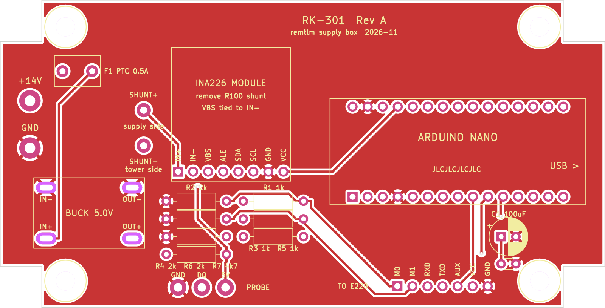
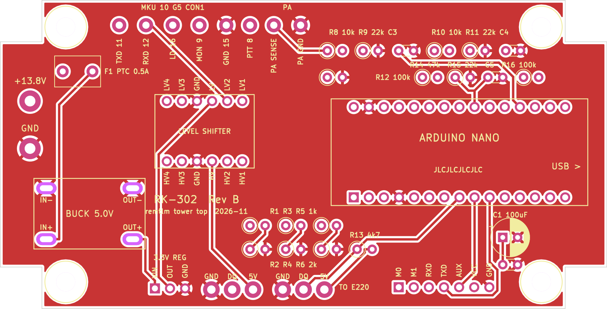
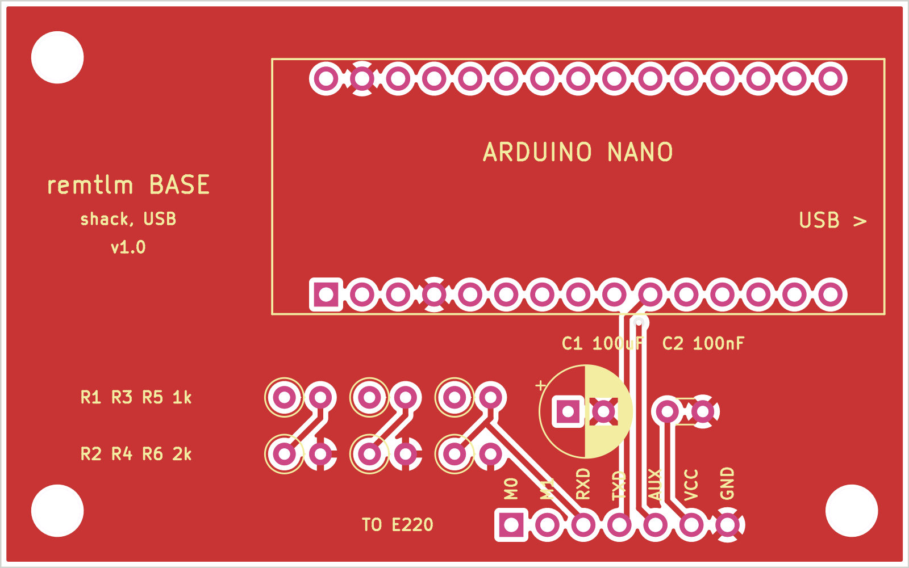

# remtlm circuit boards

Three two-layer boards for the remtlm telemetry nodes, all through-hole, built by hand, with the modules in sockets:

| Part number | Board | Folder | Size | Goes in | Holds |
|---|---|---|---|---|---|
| RK-301 Rev A | Supply box (PSU) | `psu/` | 102 × 52 mm | Hammond 1590B at the tower base | Nano, INA226 module, mini buck, polyfuse, E220 dividers, one DS18B20 |
| RK-302 Rev B | Tower top | `tower/` | 102 × 52 mm | Hammond 1590B at the tower top | Nano, mini buck, AMS1117-3.3, BSS138 shifter, PA/MKU conditioning, key-line (MKU PTT out) sense, two DS18B20s |
| RK-303 Rev A | Shack (BASE) | `shack/` | 64 × 40 mm | No enclosure; USB from the shack PC | Nano, E220 dividers |

Part numbers, revisions and the rules for changing them are in [`REVISIONS.md`](REVISIONS.md). Each folder has the KiCad 7 board (`*.kicad_pcb`), a Gerber + drill zip for the fab (`fab/<pn>-rev<rev>-*-gerbers.zip`), a parts list (`*-bom.csv`), top and bottom renders (`img/`) and the DRC report (`*.drc.txt`).







## Checking the fit on paper

Each `fab/` folder has a `*-print-letter.pdf`: the pads, outlines, labels and board edge at full size on US Letter, with a 100 mm scale bar. Print it at 100% (Actual size, not Fit), then measure the bar. It must be exactly 100 mm. Push the modules' pins through the pad dots into a piece of foam or cardboard to check every footprint. (`*-print-1to1.pdf` is KiCad's own A4 plot of the same thing.)

## Ordering (JLCPCB)

Upload the zip from `fab/` as it is. Under "Remove Order Number", choose **Specify a location**: each board has `JLCJLCJLCJLC` printed under the Nano, where JLCPCB will put its number. The defaults are fine: 2 layers, 1.6 mm FR-4, 1 oz copper, HASL. The four buck-module holes are plated slots (1.0 × 2.2 mm). JLCPCB makes those without extra charge, and they show up as slots in the drill file.

## How the boards connect

The nets are the same as the schematics in `docs/img/`:

- `remtlm-psu-box-schematic.svg` (supply box)
- `remtlm-tower-signals-schematic.svg` and the logic-supply part of `remtlm-tower-power-schematic.svg` (tower top; there's no shunt or INA226 at the top)
- `remtlm-e220-schematic.svg` (all three)

The Nano pin numbers match `firmware/remtlm/config.h`. The KiCad files are boards only, not schematic files: each board is described in a short Python script in `gen/`, which places the parts and gives every pad its net. The Python script `gen/route.py` then checks every pad against that list after routing.

### Wires soldered into the board

| Wire | Hole | Pad | Used for |
|---|---|---|---|
| #16 | 1.8 mm | 3.6 mm | Supply in (+ and GND) |
| #18 | 1.4 mm | 2.8 mm | DS18B20 probes (GND, DQ, 5V) |
| #20 | 1.2 mm | 2.4 mm | Shunt Kelvin leads; MKU CON1 pins 11, 12, 16, 9, 15; PA sense and PA ground |

### E220 ribbon

The 1 × 7 header on each board runs M0, M1, RXD, TXD, AUX, VCC, GND, in the module's own pin order. The 5 V → 3.3 V dividers for M0, M1 and RXD are on the main board, so the ribbon carries 3.3 V-level signals. The board has 100 µF + 100 nF at the header. Put another 100 µF across VCC/GND at the E220 end of the ribbon, on the daughterboard.

## Build notes

- **Sockets and headers** (not in the BOMs):
  - Nano: two 1 × 15 female headers on every board.
  - Supply box: a 1 × 8 for the INA226 module.
  - Tower: two 1 × 6 for the shifter and a 1 × 3 for the AMS1117 module.
  - Buck module: four header pins, one in each corner pad.
- **Buck module:** a fixed 5 V output module (5–28 V in), so there's nothing to set; measure its output once for `VREF_MV`. The board marks IN+, IN−, OUT+ and OUT− at the four slots. Check them against the labels printed on the module's underside before soldering. Viewed from above with the inductor on the right, the corners are IN− top-left, OUT− top-right, IN+ bottom-left and OUT+ bottom-right.
- **INA226 module (supply box):**
  - Remove its R100 shunt resistor; the external shunt does the work (or set `SHUNT_UOHM` as the README describes).
  - The board ties VBS to IN−, so bus voltage is measured on the tower side of the shunt.
  - SHUNT+ goes to the supply side of the shunt.
- **Polyfuse:** a radial PTC with 0.5 A hold / 1.0 A trip, rated for at least 30 V (e.g. Littelfuse RXEF050), on 5 mm lead spacing. It protects the board's own logic supply only; the main load current never passes through these boards.
- **Level shifter (tower):** the module sits rotated 180°, LV row towards the transverter wires. LV1 carries MKU TXD (CON1 pin 11) to D11, and LV2 carries MKU RXD (pin 12) from D12. Channels 3 and 4 are unused.
- **AMS1117-3.3 module (tower):** stands upright in a 1 × 3 socket. The board follows the module's VIN, OUT, GND pin order. OUT is the middle pin.
- **Mounting:** #4-40 hardware (standoff, split washer, pan-head screw) in 3.2 mm unplated holes near the corners: four each on RK-301 and RK-302, three on RK-303. A 7.6 mm circle around each hole is kept free of copper on both sides, so the hardware doesn't touch traces or ground the board to the box.
- **USB:** each Nano sits with its USB end towards the right-hand short wall. Drill one hole there to reflash without opening the box.

## What has and hasn't been checked

Checked:
- KiCad DRC: no clearance errors and no unconnected pads.
- Every pad is on its intended net.
- The Nano pin assignments match `config.h`.
- Paper fit check: the buck, INA226 and Nano matched the full-size prints, and the 100 mm scale bar printed true.
- The board size is inside Hammond's 105 × 53.45 mm maximum for the 1590B, with corner notches for the lid-screw bosses.

Not yet checked:
- Paper fit of the level shifter and the AMS1117 module (from photos only).
- The stack height under the 1590B lid with your standoffs.
- A fabricated board.

The remaining DRC warnings are harmless. Most are notices that the generated boards aren't tied to a KiCad library table. The rest are "starved thermal" notes: a ground pad with fewer than the full set of spokes on one layer, still connected through the other.

## Regenerating

Built with KiCad 7.0 (Ubuntu 24.04 packages) and Freerouting 2.1.0 (Java 21). From `hardware/`:

```
./build.sh
```

Part numbers and revisions come from `boards.json`. This runs `gen/<board>.py` to place parts and assign nets, `gen/route.py` to route with Freerouting, pour GND, run DRC and check the nets, and `gen/fab.py` to write the Gerbers, BOM and renders. Change a script and rerun; routing takes a few seconds per board, and a board is re-routed automatically (up to 5 tries) if Freerouting leaves anything unconnected.
